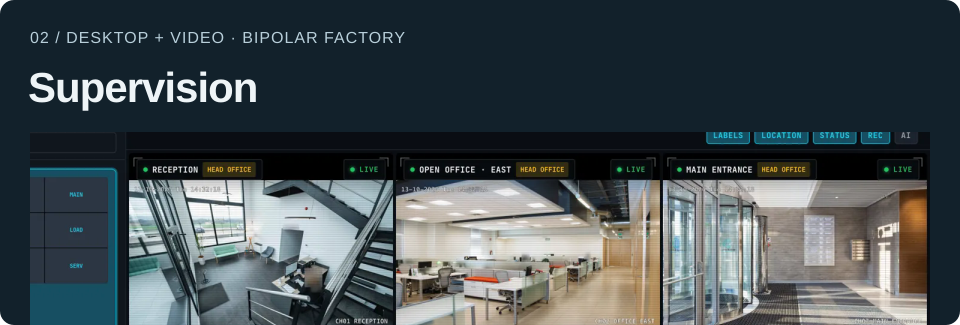

<picture>
  <source media="(max-width: 1011px)" srcset="assets/intro-mobile.svg">
  
</picture>

I build Android apps in **Kotlin and Java**, and share code and UI with iOS using **Kotlin Multiplatform and Compose Multiplatform**. The interesting bugs usually turn up after a network switch or a trip to the background.

[Email](mailto:saifahmed9308@gmail.com) · [LinkedIn](https://www.linkedin.com/in/mohd-saif-ahmed-200882219) · [Writing](https://medium.com/@saifahmed9308)

## Out in the world

<a href="https://babysday.in">
<picture>
  <source media="(max-width: 1011px)" srcset="assets/baby-mobile.svg">
  
</picture>
</a>

**[Baby’s Day In](https://babysday.in)** · Bipolar Factory · [Android](https://play.google.com/store/apps/details?id=com.bipolarfactory.miraapp) / [iOS](https://apps.apple.com/us/app/babys-day-in/id6773022911)

I work on shared Compose UI and WebRTC streaming, including camera and audio lifecycles on both platforms. Store releases and crash diagnostics are part of the job, too.

<a href="https://supervisionvms.com">
<picture>
  <source media="(max-width: 1011px)" srcset="assets/supervision-mobile.svg">
  
</picture>
</a>

**[Supervision](https://supervisionvms.com)** · Bipolar Factory

Desktop video software: multi-camera viewing, playback, and footage export. I've worked across the React/Tauri client and Go recording backend, including recording reliability.

### Earlier Android work

- **[Vrid](https://vrid.in)** — personal finance; Compose screens, UI profiling, and tests.
- **[Stock Register](https://www.stockregister.in)** — inventory and billing; inventory and sign-in features, local data, and sync.
- **[WUS](https://www.workerunionsupport.com)** — worker support; reusable Compose UI, analytics, and crash reporting.

These were internship roles. I’ve also worked on production Android software in Java at Tayseer Technologies.

## On the workbench

**[LogBridge](https://github.com/SAIF879/LogBridge)** — an Android tool of my own. Text logs go through a native parser and become structured entries I can search, filter, and keep offline. Compose for the UI; Kotlin/JNI at the native boundary.

**[When Android kills the process](https://github.com/SAIF879/SimulatingProcessDeath)** — a small `SavedStateHandle` experiment, with [notes on what survives](https://medium.com/@saifahmed9308/oops-android-killed-my-app-again-16b475c0e829). Rotation and process death are very different kinds of “the app came back.”
